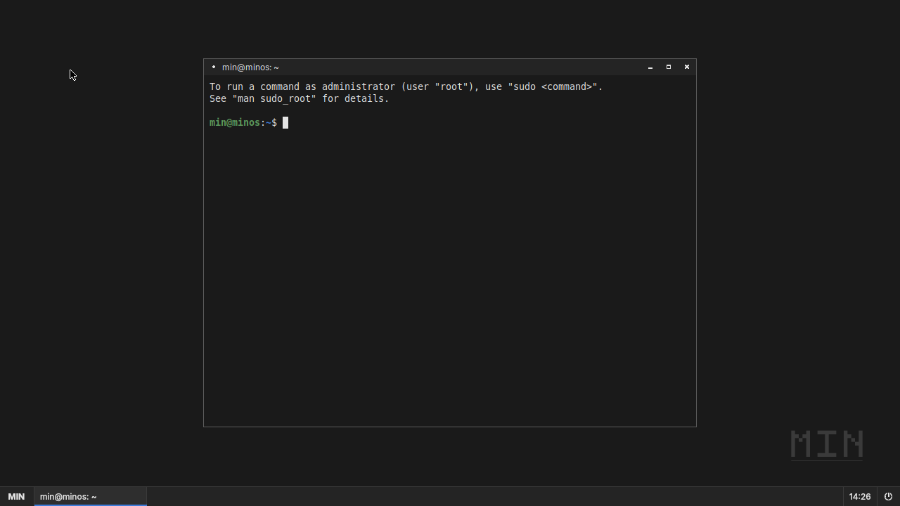

# 하그라 (HAGRA)

> 한국의 미감과 생활에 대한 이해를 바탕으로, 누구나 자기 일을 편안하게 해낼 수 있도록 만드는 운영체제.
>
> 2026-10-24: 프로젝트 이름을 MIN OS 에서 **하그라**로 바꿨다. 영문 HAGRA 는 임시 표기다. 내부 식별자(`minos-*`)는 의존 관계 확인 후 단계적으로 바꾼다.
> 철학: `docs/HAGRA_PHILOSOPHY.md` · UI 기반: `docs/UI_FOUNDATION.md` · 디자인 전달 명세: `docs/DESIGN_HANDOFF.md`

하그라는 Debian Stable 위에 자체 사용자 인터페이스, 시스템 애플리케이션, 부팅 경험,
설정 시스템을 갖춘 경량 데스크톱 운영체제입니다. 테마나 데스크톱 커스터마이징이 아니라,
실제 PC에 설치해 일상적으로 사용할 수 있는 독자적인 데스크톱 운영체제를 목표로 합니다.

| 항목 | 선택 |
|---|---|
| Base | Debian Stable (현재 Debian 13 "trixie") |
| Architectures | x86-64 (PC, live ISO) · ARM64 (Android/Termux QEMU, qcow2 번들) |
| Kernel | Linux (Debian 커널 패키지) |
| Display | Wayland |
| Compositor | Labwc (wlroots 기반, 초기 단계) |
| Desktop UI | Qt 6 / QML |
| System code | Rust (데몬·설치기 백엔드), C++ (Qt UI) |
| Packages | APT (.deb) |
| Image build | mmdebstrap + 자체 스크립트 (`image/`) |
| Testing | QEMU / KVM, 헤드리스 labwc |

## 저장소 구조

```
MIN-OS/
├── README.md                 이 문서
├── DEVELOPMENT_PLAN.md       마일스톤 및 일정
├── Makefile                  최상위 진입점 (deps / shell / image / run / test)
├── design/                   디자인 토큰 원본·생성기·자산·대표 장면 (하그라 디자인 적용 기반)
│   ├── tokens/hagra.tokens.json   단일 토큰 원본 (임시값)
│   ├── tools/gen_tokens.py        Theme.qml / labwc themerc / foot.ini 생성·검증
│   ├── assets/                    아이콘(SVG)·배경 자산 (디자인 담당 제공 예정)
│   └── scenes/                    대표 검증 장면 (FilesScene: 예제 데이터 파일 탐색 화면)
├── tools/preview/            minui-preview: QML 미리보기 실행기
├── docs/
│   ├── HAGRA_PHILOSOPHY.md   하그라 제품·디자인 철학
│   ├── UI_FOUNDATION.md      토큰·공통 부품·갤러리·대표 장면 실행법
│   ├── DESIGN_HANDOFF.md     디자인 담당에게 전달하는 기술 명세
│   ├── ARCHITECTURE.md       시스템 아키텍처
│   ├── DESIGN_LANGUAGE.md    (이전) Graphite 디자인 언어 — 임시 기준
│   ├── MILESTONE_1.md        첫 번째 마일스톤 구현 계획 및 검증 방법
│   ├── BUILD_ENVIRONMENT.md  빌드 환경 요구사항과 제약
│   ├── ARM64_ARCHITECTURE.md ARM64/x86-64 공통 구조와 차이
│   ├── ANDROID_EMULATION.md  Android(Termux) 에서 QEMU 로 MIN OS 실행
│   └── ANDROID_PERFORMANCE.md 모바일 성능 측정·튜닝
├── scripts/
│   └── install-deps.sh       호스트 개발 의존성 설치 (Debian/Ubuntu)
├── android/                  Termux 실행/설치 스크립트 (start-minos.sh, install-termux.sh)
├── image/                    부팅 이미지 빌드 파이프라인 (x86-64 ISO · ARM64 디스크 번들)
│   ├── build.sh              rootfs → MIN 컴포넌트 빌드 → squashfs+ISO 또는 GPT/ext4+qcow2
│   ├── config/
│   │   ├── suites/           대상 배포판 프로필 (debian-trixie, ubuntu-noble)
│   │   ├── packages.*        패키지 목록 (base / desktop / dev)
│   │   └── hooks/            chroot 내부에서 실행되는 커스터마이즈 스크립트
│   ├── grub/                 ISO용 GRUB 설정 (BIOS + UEFI)
│   └── qemu/run.sh           QEMU 실행 스크립트
├── session/                  MIN 세션: greetd 설정, minos-session, labwc rc.xml, foot 설정
├── shell/                    MIN Shell (작업 표시줄, 실행 메뉴, 트레이, 시계, 알림, 창 전환)
├── libs/
│   ├── minlayershell/        Qt 6용 wlr-layer-shell 클라이언트 통합 (패널을 화면 가장자리에 고정)
│   └── minui/                MinUI: QML 공통 부품 모듈 (생성된 Theme + 부품 20종, gallery/ 갤러리)
├── files/                    MIN Files (파일 관리자)          — M3
├── settings/                 MIN Settings (설정)              — M4
├── terminal/                 MIN Terminal (터미널)            — M5
├── installer/                MIN Installer (설치기)           — M6
└── tests/
    ├── shell/                헤드리스 labwc에서 MIN Shell 실행·스크린샷 검증
    └── image/                QEMU 부팅·종료·재부팅 자동 검증
```

## 현재 상태 (M1 + ARM64)


x86-64 QEMU(UEFI)에서 부팅한 개발 이미지: labwc 세션 위의 MIN Shell 패널과 실행 메뉴.



ARM64 디스크 번들을 QEMU `virt` 머신(TCG, virtio-gpu 1280×720)으로 부팅한 화면. 같은 셸·세션 코드가 두 아키텍처에서 동작한다.
Galaxy S25 Ultra 실기기 검증은 아직 수행되지 않았다. `DEVELOPMENT_PLAN.md` 참고.

## 빠른 시작

```sh
# 1. 호스트 의존성 (Debian 13 / Ubuntu 24.04)
sudo scripts/install-deps.sh

# 2. MIN Shell 호스트 빌드 + 헤드리스 테스트 + 토큰 검증
make shell
make test-shell
make tokens-check
# 2b. 디자인 검증 캡처 (부품 갤러리 3배율, 대표 장면)
make design-captures

# 3. 부팅 이미지 빌드 (기본: Debian trixie. Debian 미러가 막힌 환경에서는 SUITE=ubuntu-noble)
sudo make image              # 결과: out/minos-dev-<suite>-<arch>.iso
sudo make image SUITE=ubuntu-noble

# 4. QEMU에서 부팅 (KVM이 있으면 자동 사용)
make run                     # 그래픽 창
make run-serial              # 시리얼 콘솔만 (헤드리스 서버)

# 5. 자동 부팅 테스트 (부팅 → 로그인 → 세션 확인 → 종료 → 재부팅)
sudo make test-image

# 6. ARM64 (Android/Termux 용) 번들: out/minos-arm64/ → make bundle-android → 휴대폰으로 복사
sudo make image-arm64 SUITE=ubuntu-noble
sudo make test-image-arm64          # PC QEMU(TCG)에서 ARM64 부팅·세션·재부팅·종료 검증
make bundle-android                 # out/minos-android-arm64.tar.zst
```
Android 에서의 실행 방법은 `docs/ANDROID_EMULATION.md` 를 참고하십시오.

### Android 에서 바로 실행 (PC 불필요)
Termux 와 VNC 앱(AVNC)을 설치한 뒤 Termux 에 붙여넣습니다. GitHub Actions 가 빌드·테스트한 이미지를 내려받아 실행합니다.
```sh
curl -fsSL https://raw.githubusercontent.com/Geroroy/MIN-OS/ccr-0dc4d66d-j60c3m/android/setup.sh | bash
```

자세한 내용은 `docs/MILESTONE_1.md`와 `docs/BUILD_ENVIRONMENT.md`를 참고하십시오.

## 개발 원칙

1. 실제로 실행되는 코드를 작성한다. 작동 여부는 추측이 아니라 테스트 결과로 확인한다.
2. 불필요한 의존성을 최소화한다. 초기 단계에서는 안정적인 기존 컴포넌트를 재사용한다.
3. 기존 Linux 드라이버·APT 생태계와의 호환성을 유지한다.
4. 모든 주요 기능에 테스트를 둔다. 단계가 끝날 때마다 실행·검증 방법을 제공한다.
5. 프로젝트를 컴포넌트 단위 모듈로 구성하고, 각 컴포넌트는 독립적으로 빌드·패키징된다.
6. 빌드와 테스트는 호스트의 파티션·부트로더·개발 환경을 건드리지 않는다
   (모든 작업은 chroot, 이미지 파일, QEMU 안에서만 수행된다).

## 라이선스

MIN OS 고유 코드: GPL-3.0-or-later (예정). 포함된 Debian 패키지는 각자의 라이선스를 따릅니다.
