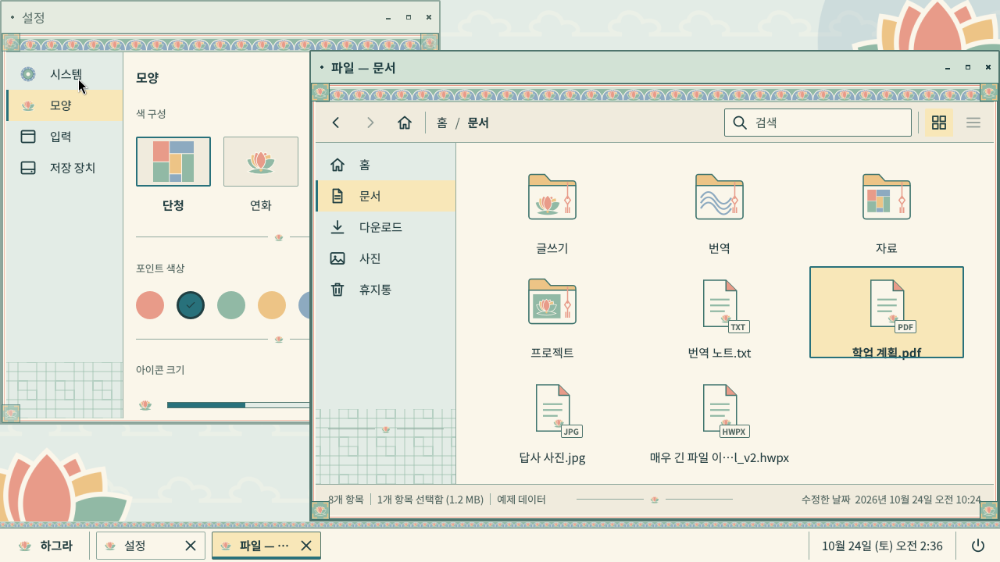

# UI 구현 기반 — 토큰·공통 부품·갤러리·대표 장면

> 2026-10-24 기준. 기존 M0/M1(x86-64 ISO, ARM64 번들) 과 Android 트랙은 그대로 두고, 그 위에 디자인을 받아 적용·비교할 수 있는 기반을 더한 것이다.
> H1(같은 날): 디자인 패키지 `design/hagra-dancheong-v1/`(연한 단청)을 이 기반 위에 적용했다. §2.2(장식 범위), §2.3(패널 구조), §4.2(기준 시안 대비 차이) 참고.
> H2(2026-10-26): 선택형 테마 시스템과 두 번째 테마 "깊은 단청"(`design/hagra-dancheong-v2/`). §7(테마 시스템), §4.3(깊은 단청 시안 대비 차이).

## 1. 토큰: 한곳에서 관리

```
design/tokens/hagra.tokens.json   ← 단일 원본 (JSON, hagra-dancheong-v1, status design-v1)
        │  python3 design/tools/gen_tokens.py        (--check: 어긋나면 실패)
        ├─► libs/minui/qml/MinUI/Theme.qml           QML 앱 내부 UI (MinUI 싱글톤)
        ├─► session/labwc/themerc-override          labwc 서버 측 창 장식·루트 메뉴·Alt+Tab OSD
        └─► session/foot/foot.ini                   foot 터미널 색상
```

- 생성된 세 파일은 헤더에 "생성된 파일" 표시가 있고 직접 수정하지 않는다. `make tokens` 로 재생성, `make tokens-check` 로 검증한다.
- 셸 패널(`shell/qml`)은 MinUI `Theme` 을 그대로 쓰므로 별도 반영이 필요 없다.
- 적용 범위가 다른 이유: labwc 와 foot 은 QML 이 아니라 각자의 설정 파일을 읽는다. 생성기가 같은 값을 각 형식으로 써 준다.
  값이 어긋나면 `--check` 가 실패하므로 CI/`make test` 에서 잡는다.
- 토큰 JSON 의 `_meta.status`: `design-v1` = 디자인 패키지 v1 의 값(원본 `design/hagra-dancheong-v1/tokens.json`, 구현을 위해 window/size/font 토큰을 보강). 터미널 팔레트는 아직 provisional.
- `session/labwc/rc.xml` 의 글꼴(Noto Sans CJK KR 12pt, 활성 굵게)과 `cornerRadius` 는 생성 대상이 아니므로 수동으로 맞춘다 (themerc 에는 해당 키가 없다).

### 1.1 논리 픽셀과 실제 픽셀

| 층 | 단위 | 비고 |
|---|---|---|
| QML (MinUI, 셸, 앱) | **논리 픽셀** (배율 1.0 기준) | Qt 가 Wayland 출력 배율(정수) 또는 `QT_SCALE_FACTOR` 를 곱해 실제 픽셀로 그린다 |
| labwc themerc | **실제 픽셀을 출력 배율로 나눈 값**, 즉 논리 픽셀 | labwc 가 출력 배율을 곱한다. `border.width: 1` 은 2× 출력에서 2px |
| labwc 글꼴 | **pt** (`<font size="9">`) | 배율과 DPI 를 labwc/pango 가 처리 |
| foot | 글꼴 pt, 패딩 px(논리) | foot 이 출력 배율을 적용 |
| 캡처 PNG | 실제 픽셀 | 1280×720@1× → 1280×720, 2560×1440@2× → 2560×1440 |

Qt 6.4 는 분수 배율 프로토콜(`wp-fractional-scale-v1`)이 없어 1.5× 출력에서는 컴포지터가 1× 또는 2× 버퍼를 확대한다(흐림).
갤러리의 150% 캡처는 `QT_SCALE_FACTOR=1.5`(앱 논리 배율)로 배치를 검증하는 용도다.

## 2. 공통 부품 (MinUI, `libs/minui/qml/MinUI/`)

QML 로 직접 작성했다. Qt Quick Controls 를 쓰지 않는 이유와 제약:

- 이유: 각진 형태·1px 테두리·상태 단서를 토큰 하나로 통제하고, Controls 의 스타일 계층(Basic/Fusion)과 애니메이션을 피하며,
  Qt 6.4 ~ 6.8 에서 동일하게 보이게 하기 위해서다. 의존성이 QtQuick 만으로 줄어 소프트웨어 렌더링 비용도 낮다.
- 제약: Controls 가 제공하는 접근성 트리(`Accessible` 역할), 입력 메서드 힌트, 휠·터치 기본 처리를 직접 붙여야 한다.
  현재 `Accessible.role` 은 붙이지 않았다 → 후속 과제. 키보드 탐색은 `activeFocusOnTab` + `Keys` 로 구현했다.
- 선택과 포커스는 독립이다: 선택 = `selection` 배경 + 왼쪽 3px 막대(또는 하단 막대), 포커스 = 1px 링(`focusRing`).

| 부품 | 파일 | 구현 주체 | 상태 지원 (기본/호버/눌림/선택/포커스/비활성/오류/진행) |
|---|---|---|---|
| 창 프레임 | labwc SSD (`session/labwc/themerc-override`) | **컴포지터** | 활성/비활성만. 호버는 버튼 배경. QML 은 관여 못 함. `MWindowFrameMock` 은 미리보기 모형 |
| 버튼 | `MButton.qml` | MinUI | 전부 |
| 입력칸 | `MTextField.qml` | MinUI | 전부 + 한글 조합 중 표시(`composing`) |
| 검색창 | `MSearchField.qml` | MinUI | 입력칸과 동일 + 지우기 |
| 메뉴 | `MMenu.qml` (앱 내) / labwc 루트 메뉴 / 셸 메뉴(layer-shell) | MinUI · 컴포지터 · 셸 | 호버/선택(현재)/비활성/구분선/체크. 창 경계 안에서만 |
| 탭 | `MTabBar.qml` | MinUI | 기본/호버/현재/포커스/비활성 |
| 체크박스 | `MCheckBox.qml` | MinUI | 전부(진행 제외) |
| 라디오 | `MRadioButton.qml` + `MRadioGroup.qml` | MinUI | 전부(진행 제외) |
| 선택 목록 | `MComboBox.qml` | MinUI | 버튼과 동일, 목록은 MMenu |
| 목록 행 | `MListRow.qml` | MinUI | 기본/호버/선택/포커스/비활성 |
| 스크롤바 | `MScrollBar.qml` | MinUI | 기본/호버/드래그 |
| 툴팁 | `MToolTip.qml` | MinUI | 표시/숨김 (창 안) |
| 알림 | `MNotification.qml` | **셸 소유**(M2 에서 layer-shell 창) | 기본/긴급/동작 버튼 |
| 대화상자 | `MDialogWindow.qml`(별도 창, labwc 장식) / `MDialogContent.qml` | MinUI + 컴포지터 | 기본 버튼/거부/파괴적 |
| 진행 표시 | `MProgressBar.qml`, `MBusyBar.qml` | MinUI | 확정/불확정/오류 |
| 앱 실행·전환 영역 | `shell/qml/Panel.qml`, `Launcher.qml` | **셸** | 활성 창 = 하단 막대 |
| 아이콘 | `MIcon.qml` | MinUI | 모듈 `assets/<name>.svg` → 외부 아이콘 디렉터리 → 자리 표시자. 비활성은 흐림 |
| 연화 띠 | `MOrnamentBand.qml` | MinUI (앱 내부 장식) | 가로 타일(108×18 SVG), `compact`(8px, 패널). 입력 없음. 자산 없으면 겹선 대체 |
| 장식 프레임 | `MOrnamentFrame.qml` | MinUI (앱 내부 오버레이) | 청록 2px + 산호 1px 겹선 + 모서리 결구 4개. 활성/비활성(불투명도). SSD 가 아님 |
| 장식 구분선 | `MOrnamentDivider.qml` | MinUI | 얇은 선 + 연꽃 포인트 (상태줄·사이드바·대화상자) |

### 2.1 시스템 소유 UI 와 외부 앱

| 범위 | 테마 적용 |
|---|---|
| 하그라 셸·하그라 앱(QML) | MinUI 토큰 100% |
| 창 장식·루트 메뉴·Alt+Tab | labwc themerc (토큰 생성) — 모든 창에 동일 적용(SSD) |
| 터미널(foot) | foot.ini 색상(토큰 생성) |
| 외부 Qt 앱 | 창 장식만 동일. 내부는 앱의 스타일. (후속: Qt 플랫폼 테마 플러그인으로 색상 제안 가능) |
| 외부 GTK 앱 | 창 장식만 동일(CSD 앱은 그마저도 자체). GTK 테마는 별도 작업이며 강제할 수 없다 |
| 웹 콘텐츠 | 적용 불가 |

### 2.2 전역 창 장식(labwc SSD) 과 앱 내부 장식의 범위  (H1)

기준 시안의 창은 제목 아래 연화 띠, 모서리 결구, 겹선 테두리를 가진다. labwc 0.7 의 서버 측 장식(SSD)은 themerc 의 단색 키만 지원하므로 두 층으로 나눈다.

| 층 | 그리는 주체 | 적용 범위 | 내용 |
|---|---|---|---|
| 전역 창 장식 | labwc (`session/labwc/themerc-override`, 생성) | **모든 창** (외부 앱 포함) | 제목 배경 활성 `#D2E2D5` / 비활성 `#E5EBE0`, 제목 글자 `#203F42`/`#536963`, 활성 굵게·비활성 보통(rc.xml 글꼴), 테두리 2px 활성 `#4F756D` / 비활성 `#90A99E`, 창 버튼 호버 산호 `#E89B89`, 모서리 반경 2. 문양 이미지는 **불가**(지원 키 없음, 비표준 키를 넣지 않는다) |
| 앱 내부 장식 | 하그라 앱·셸 (QML `MOrnamentBand`/`MOrnamentFrame`/`MOrnamentDivider`) | 하그라가 직접 그리는 창만 | 제목 바로 아래 18px 연화 띠, 콘텐츠 둘레 겹선 + 모서리 결구(inset 6), 상태줄 연꽃 구분선, 사이드바 창살 |
| 셸 | `shell/qml` | 패널·실행 메뉴·전원 메뉴 | 패널 상단 8px 띠, 팝업 상단 18px 띠, 2px 청록 경계 |
| 외부 앱(GTK/Qt/CSD) | 각 앱 | — | 전역 장식(1층)만 동일. 내부 띠·결구는 적용되지 않는다 |

활성/비활성 구분은 색 외에 **제목 굵기**(굵게/보통)와 **테두리 색 단계**, 앱 내부 프레임의 불투명도로 나타난다.
labwc 제목 표시줄 높이는 글꼴 높이 + 2×`titlePaddingY`(8) 로 약 40px 이며 직접 지정할 수 없다(0.8 부터 `titlebar.height`).
창 제목에 앱 아이콘을 넣는 것(기준 시안의 연꽃)은 labwc 0.7 SSD 로는 불가 → 차이로 기록.

### 2.3 패널 구조 (52 논리 px)

```
y=0   ┌──────────────────────────────┐  8px  MOrnamentBand { compact: true }  (입력 없음)
y=8   ├──────────────────────────────┤  1px  borderStrong
y=9   │ [연꽃 하그라] │ 창 항목 … │ 시계 │ ⏻ │ 43px 콘텐츠 (컨트롤 36, 세로 중앙)
y=52  └──────────────────────────────┘
```
`exclusiveZone = Theme.panelHeight`. 실행 메뉴(360×440)·전원 메뉴(240)는 overlay 레이어에 `marginBottom: 0` 으로 두면 컴포지터가 exclusive zone 위에 올린다
(이전 코드의 `marginBottom: panelHeight` 는 높이를 두 번 더해 패널과 틈이 생겼고, 느슨한 픽셀 검사가 이를 놓쳤다 → 검사에 경계선 y 좌표 확인 추가).
시계는 `Date.toLocaleString(Qt.locale("ko_KR"), "M월 d일 (ddd) AP h:mm")` 로 런타임 시계를 읽는다. 트레이(네트워크·볼륨·배터리)는 M2.

## 3. 갤러리

```sh
make shell                                   # build/tools/preview/minui-preview 포함
build/tools/preview/minui-preview libs/minui/gallery/Gallery.qml --state buttons [--scale 1.5]
   # 섹션: buttons inputs selection lists feedback text ornament icons frame
tests/design/capture-gallery.sh              # 9 섹션 × 100/150/200% → out/design/gallery/<섹션>-<배율>.png
```
갤러리는 헤드리스 labwc(pixman) + Qt Wayland(software) 에서 실행되므로 이미지와 같은 경로로 그려진다.

## 4. 대표 장면

"하그라 바탕화면에서 파일 관리자를 열고, 문서 폴더의 파일을 선택하는 장면"

```sh
tests/design/capture-scene.sh    # out/design/scene/scene-100-{default,menu,dialog}.png, scene-fhd-default.png(1920×1080), scene-200-default.png
build/tools/preview/minui-preview design/scenes/FilesScene.qml --state menu   # 직접 실행
```
구성: 배경(swaybg, 사전 렌더링 `session/wallpaper/hagra-dancheong.png`) + 셸 패널(minos-shell, 실제 창 목록) + 비활성 창(`SettingsScene.qml`, 설정→모양 예제) + 활성 창(`FilesScene.qml`). 1920×1080 캡처에는 `NotesScene.qml`(긴 텍스트·탭)을 추가한다.
창 장식·이동·크기 조절·창 제어는 labwc 가 실제로 처리한다(모형 아님). **파일 목록은 예제 데이터이며 실제 파일 작업은 없다.**
실제 파일 관리자는 M3 에서 `files/` 에 구현하며, 이 장면의 레이아웃·부품을 그대로 가져간다.

캡처 환경: 1280×720@1×, 1920×1080@1×, 2560×1440@2×(wlr-randr 출력 배율 → labwc 장식도 확대). 창 배치는 캡처용 설정에서 `automatic`.

### 4.1 현재 캡처 (연한 단청 v1, 2026-10-24)

| 장면 | 파일 |
|---|---|
| 파일 장면 1280×720 기본 / 메뉴 / 대화상자 | `docs/screenshots/h1/scene-files-100.png`, `-menu.png`, `-dialog.png` |
| 파일 장면 1920×1080 (메모 창 추가) | `docs/screenshots/h1/scene-files-fhd.png` |
| 파일 장면 200% (2560×1440 → 축소본) | `docs/screenshots/h1/scene-files-200-downscaled.png` |
| 기준 시안 ↔ 캡처 비교 | `docs/screenshots/h1/compare-reference-vs-capture.png` |
| 셸: 실행 메뉴 / 전원 메뉴 / 터미널+작업 표시줄 (헤드리스 테스트 출력) | `docs/screenshots/h1/shell-launcher.png`, `shell-power.png`, `shell-foot.png` |
| 갤러리 9섹션 100%, text 200% | `docs/screenshots/h1/gallery-*-100.png`, `gallery-text-200.png` |
| (이력) H0 Graphite 캡처 | `docs/screenshots/h0/` |



### 4.2 기준 시안 대비 차이 목록 (2026-10-24)

기준: `design/hagra-dancheong-v1/reference/hagra-dancheong-concept.png` (1672×941). 캡처: 1280×720 실제 세션.

| # | 항목 | 기준 시안 | 현재 구현 | 판단 |
|---|---|---|---|---|
| 1 | 창 제목줄 | 제목 왼쪽 연꽃 아이콘, 산호색 닫기 버튼 위 꽃 문양 | labwc SSD: 청자 제목·짙은 글자, 표준 × − □ 아이콘, 아이콘 없음 | 의도된 차이. 조작 기호는 표준 유지(CLAUDE_TASK). 제목 아이콘은 labwc 0.7 SSD 미지원 |
| 2 | 제목 아래 연화 띠 | 창 폭 전체, 약 20px | 앱 내부 `MOrnamentBand` 18px (SSD 제목줄 바로 아래) | 일치. 외부 앱에는 없음 (§2.2) |
| 3 | 창틀 | 겹선 + 모서리 결구가 제목줄까지 감쌈 | 결구·겹선은 콘텐츠 영역(제목줄 아래)만 감쌈, 제목줄은 2px 단색 경계 | labwc 제약. 제목줄 테두리색은 같은 청록 |
| 4 | 좌측 레일 (6개 아이콘) | 있음 | 없음 | 실제 실행·키보드 탐색·예약 영역이 준비되지 않아 추가하지 않음(지시서 6항). 후속 |
| 5 | 하단 패널 | 연꽃 시작 버튼, 창 항목(아이콘·제목·×), 트레이(^ 와이파이 볼륨 배터리), 날짜·시각, 오른쪽 연꽃 | 연꽃+하그라, 창 항목(아이콘·제목·×, 활성 강조), 날짜·시각, 전원 버튼. 트레이 없음 | 트레이는 M2. 패널 띠는 8px 축소형(52px 안에 36px 컨트롤 유지) |
| 6 | 사이드바 선택 행 | 산호색 배경 + 흰 글자 | 연살구 선택 배경(`selection` #F8E7B8) + 짙은 글자 + 3px 청록 막대 | 명세 "연한 색 위 흰 글자 금지", 선택 토큰 일관성 우선. 디자인 담당 확인 필요 |
| 7 | 폴더 아이콘 | 수채 질감, 매듭 술 장식, 큰 크기(~120px) | 패키지 SVG 그대로 72px (`folderIconSize`) | 자산 해상도·질감 차이. SVG 는 패키지 원본(수정 없음) |
| 8 | 파일 아이콘 | 유형별 그림(PDF 로고, 사진 썸네일) | 공통 document.svg + 유형 배지(TXT/PDF/JPG/HWPX) | 지시서 "파일마다 다른 상징 강제 금지" 에 따름. 작은 크기에서도 유형 구분 가능 |
| 9 | 선택 항목 | 연살구 배경 + 청록 2px 테두리 | 연살구 배경 + 1px 살구 테두리, 키보드 포커스 시 2px 청록 링 | 선택과 포커스를 분리(명세 "선택: 포커스와 별도 상태"). 둘 다 있으면 시안과 동일 |
| 10 | 사이드바 하단 | 옅은 창살 + 매듭 술 | 창살 타일(불투명도 0.55) + 연꽃 포인트 구분선 | 매듭 SVG 가 패키지에 없음 → 연꽃으로 대체. 후속: 매듭 자산 |
| 11 | 상태줄 | 항목 수 · 선택 · 가운데 연꽃 장식 · 수정 날짜 | 동일 구성 + "예제 데이터" 표기 | 일치 (예제 표기는 의도) |
| 12 | 배경 | 구름·큰 연화·창살, 오른쪽 아래 하그라 워드마크 | 패키지 wallpaper.png(구름·연화·창살), 워드마크 없음 | 워드마크는 브랜드 확정 전 |
| 13 | 설정 창 | 오른쪽 위, 색 구성 카드 3개·포인트 색·아이콘 크기 슬라이더·테두리 스타일 | 같은 구성의 예제(`SettingsScene.qml`), 배치는 labwc automatic(왼쪽 위), 슬라이더는 진행 막대 모형 | 설정 앱은 M2 |
| 14 | 글꼴 | 본문 15px 수준 | Noto Sans CJK KR 15/13/16px, 제목 12pt | 일치 |
| 15 | 창 버튼 | 산호색 닫기 배경 | 호버 시에만 산호 배경(themerc `window.active.button.hover.bg`), 평소 단색 | 명세 "닫기 ×, 장식은 주변 프레임" |

### 4.3 깊은 단청 — 시안 대비 차이 (2026-10-26)

기준: `design/hagra-dancheong-v2/reference/hagra-dancheong-concept.png`. 캡처: `docs/screenshots/h2/deep-scene-files-100.png`, 비교 `compare-deep-reference-vs-capture.png`.

| # | 항목 | 시안 | 현재 구현 | 판단 |
|---|---|---|---|---|
| 1 | 바탕 | 짙은 녹 바탕에 학·구름·연화·창살이 화면 가장자리에 집중 | v2 wallpaper.png: 구름 줄무늬 + 모서리 연화·창살. 학 없음 | 패키지 자산 그대로(학 SVG 미제공). 참고 사진은 배포하지 않음 |
| 2 | 창 제목줄 | 짙은 녹 바탕·분백 글자·연꽃 아이콘·주홍 닫기 | labwc: 활성 #28574A/비활성 #52695A, 분백 글자, 활성 굵게, 표준 × − □, 호버만 주홍 | SSD 제약(H1 과 동일). 아이콘 불가 |
| 3 | 제목 아래 띠 | 녹청·군청·주홍 연화 띠 | v2 lotus-band(녹청 바탕, 군청 호, 주홍 연꽃) 18px | 일치 |
| 4 | 창틀 | 겹테두리(녹·군청·주홍) + 모서리 | 앱 내부 `MOrnamentFrame`: 청록 2px + 주홍 1px + v2 모서리 결구 | 군청 겹선은 미구현(2색). 후속: 프레임 3색 옵션 |
| 5 | 사이드바 | 짙은 녹, 분백 글자, 선택 행은 연한 녹청 바탕·짙은 글자 | `sidebar` #28574A + `sidebarText`, 선택 = `selection` #BDD7C6 + 짙은 글자 + 황토 막대 | 일치. 흰 글씨를 밝은 선택면에 남기지 않음(지시) |
| 6 | 본문 | 분백 | `surface` #F2EADB, 글자 #20352E | 일치 (다크 모드 아님) |
| 7 | 패널 | 짙은 녹, 분백 글자, 연꽃·트레이 | `panel` #183C35 + `panelText`, 띠 8px, 황토 경계선, 활성 창 = 연한 선택면+황토 막대. 트레이 없음(M2) | 구조 일치 |
| 8 | 포커스 | — | 밝은 본문 위 군청 #203C7A 2px, 어두운 면 위 분백 | 지시서대로 |
| 9 | 좌측 레일 | 있음 | 없음 | H1 과 동일 (실제 기능 없이는 추가하지 않음) |
| 10 | 폴더·문서 아이콘 | 수채 질감·큰 크기 | v2 SVG 72px(분백 폴더, 녹청/군청/주홍 포인트) | 자산 그대로. 24/32/48/72 에서 실루엣·종류 표시 확인(갤러리 ornament) |
| 11 | 설정 창 | 색 구성 카드 3개·포인트 색 등 | 예제 `SettingsScene`(동작 안 함) + **실제** 테마 선택은 셸 `모양 설정` 창 | 실제 테마 선택 UI 는 §7.4 |

## 5. 자산 경로

| 종류 | 경로 | 설치 위치 |
|---|---|---|
| 토큰 | `design/tokens/hagra.tokens.json` | (생성물만 설치) |
| 디자인 패키지 (원본 보존) | `design/hagra-dancheong-v1/`(연한), `design/hagra-dancheong-v2/`(깊은) — tokens.json, assets/*.svg, wallpaper, reference, 문서 | — |
| 테마 팩 소스 | `design/themes/<id>/{theme.json, tokens.json, preview.png}` (경로로 패키지 자산을 가리킴) → `build/themes/<id>/` 조립 | `/usr/share/hagra/themes/<id>/` |
| 모듈 자산 (실행용) | `libs/minui/qml/MinUI/assets/<name>.svg` (패키지 사본 12 + 조작 기호 21, `assets/README.md`) | 모듈과 함께 `…/qt6/qml/MinUI/assets/` |
| 외부 아이콘(선택) | `design/assets/icons/<name>.svg` (`HAGRA_ICON_PATH`) | `/usr/share/hagra/icons/` |
| 배경 | `session/wallpaper/hagra-dancheong.png` (패키지 wallpaper.png 사전 렌더링, 1920×1080) · 이전 `min-graphite.png` 유지 | `/usr/share/minos/wallpaper/` (`MINOS_WALLPAPER` 로 교체) |
| 기준 이미지 | `design/hagra-dancheong-v1/reference/hagra-dancheong-concept.png` | — |
| 캡처 결과 | `out/design/` (git 제외), 대표본은 `docs/screenshots/` | — |

아이콘은 `MIcon { name: "folder" }` 로 참조한다. 자산이 없으면 머리글자 자리 표시자를 그린다 (현재 상태).
미리보기 실행기는 `HAGRA_ICON_PATH` 또는 `--icons DIR` 로 경로를 받는다.

## 6. 이번 작업에서 바꾼 것과 바꾸지 않은 것

| 바꿈 | 바꾸지 않음 |
|---|---|
| 토큰 원본·생성기, MinUI 부품 17종 추가/확장, 미리보기 실행기, 갤러리, 대표 장면, 캡처 스크립트 | 부팅 파이프라인 구조, 세션 흐름, 셸 동작, 테스트 시나리오, x86/ARM64 공통 UI 경로 |
| 사용자 노출 이름(GRUB 항목, `/etc/issue`, 세션 항목, 패널 브랜드 라벨, Android 안내) → 하그라/HAGRA | 내부 식별자(`minos-*`, `/etc/minos`, `MinUI`), 호스트명, 패키지 목록 |
| 배경 이미지: MIN 워드마크 제거(임시 단색) | 배경 파일명·설치 경로 |

## 7. 테마 시스템 (H2, 2026-10-26)

### 7.1 구조

```
design/themes/<id>/theme.json ──build_themes.py──► build/themes/<id>/{theme.json,tokens.json,assets/,wallpaper.png,preview.png,labwc/themerc}
                                                          │ cmake install → /usr/share/hagra/themes/<id>/
~/.config/minos/theme.conf  [appearance] theme=<id>, useThemeWallpaper=, wallpaper=      (QSettings INI, ARCHITECTURE §2.6)
~/.local/state/minos/theme/ {current, themerc-override, wallpaper, wallpaper-fill}     (ThemeManager 가 쓰는 관리 상태)
libs/hagratheme  ThemeManager (C++)  ── registerQmlTypes → QML `import HagraTheme 1.0; ThemeManager`
                                     ── bindEngine      → MinUI.Theme.applyTokens(tokens) 즉시 + changed() 마다
tools/theme      hagra-theme CLI     list | current | apply ID | reset | sync | wallpaper | wallpaper-fill | state-dir | set-wallpaper | use-theme-wallpaper | tokens
```

- **기본값과 보존**: 팩의 `default: true`(연한 단청) 또는 `/etc/minos/theme.conf` 가 기본. 저장된 선택이 없으면 기본. 설치·업데이트는 선택을 바꾸지 않는다.
- **복귀**: 알 수 없는 ID, 토큰 파싱 실패, 팩 삭제 → 기본 테마. 배경 파일만 없으면 테마는 유지하고 기본 테마 배경을 쓴다.
- **미리보기 재정의**: `HAGRA_THEME=<id>` 환경 변수는 그 프로세스에서만 적용되고 저장하지 않는다 (캡처 스크립트가 사용).
- **다른 설정과 분리**: theme.conf 의 `[appearance]` 그룹만 쓴다. 다른 그룹(예: `[sound]`, `[panel]`)은 건드리지 않는다 (단위 테스트 `otherSettingsUntouched`).

### 7.2 런타임 전환 범위

| 층 | 전환 방식 | 즉시? |
|---|---|---|
| MinUI 앱 내부(셸·미리보기·ThemeManager 를 바인딩한 앱) | `Theme.applyTokens()` — 색·창 장식 값·치수·글꼴·테마 자산(`Theme.asset()` 가 팩 assets/ 우선) | 즉시 (바인딩된 프로세스). 바인딩하지 않은 앱은 다음 실행부터 |
| labwc 창 장식·루트 메뉴·OSD | 관리 `themerc-override` 재작성 → `labwc --reconfigure`(LABWC_PID) 또는 SIGHUP | 즉시 (labwc 0.7 이 테마를 다시 읽는다; 셸 테스트에서 `read theme` 2회 확인) |
| 배경 | `hagra-theme wallpaper` 경로로 swaybg 재시작 | 즉시 |
| foot 터미널 | 기본 테마의 foot.ini 만 설치 | 바뀌지 않음 (후속) |
| 로그인 화면(greetd) | 관여하지 않음 | — |

세션 시작: `minos-session` 이 `hagra-theme sync` 로 상태 파일을 쓰고 labwc 설정 디렉터리를 `$XDG_RUNTIME_DIR/minos-labwc-<uid>/` 에 파일 단위로 조립한다
(사용자 `~/.config/minos/labwc/<파일>` > 테마 관리 `themerc-override` > `/etc/minos/labwc/`). 예전처럼 사용자 디렉터리 전체를 두면 그대로 전부 우선한다.
`autostart` 는 `MINOS_WALLPAPER`(개발·테스트) > `hagra-theme wallpaper` > 기본 파일 순으로 배경을 고른다.

### 7.3 역할 전경 토큰과 어두운 면

깊은 단청은 패널·제목·사이드바만 짙고 본문은 분백이다. 그래서 "어두운 면 위" 부품은 전용 토큰을 쓴다.

| 면 | 바탕 | 전경 | 포커스 링 | 아이콘 |
|---|---|---|---|---|
| 패널 | `panel` | `panelText` / `panelMuted` | `focusRingOnDark` | `MIcon { light: true }` → `<name>-light.svg` (분백 잉크, `Theme.lightIcons`) |
| 사이드바 | `sidebar` | `sidebarText` | `focusRingOnDark` | 위와 같음 (`MListRow { onDark }`) |
| 창 제목(labwc) | `titleActive`/`titleInactive` | `titleText`/`titleInactiveText` | — | — |
| 본문 | `surface` | `text`/`textMuted` | `focusRing` | 기본(짙은 잉크) |
| 선택면(어느 면이든) | `selection` | `selectionText` | — | 짙은 잉크 |

`Theme.isDark(color)` 로 면을 판정해 `onDark`/`light` 를 정한다. 연한 단청에서는 모두 밝은 면이므로 변형이 쓰이지 않는다(H1 캡처와 픽셀 동일).
창 본문 바탕은 어느 테마에서도 `surface` 다. `bg` 는 바탕화면 색이므로 창 본문에 쓰지 않는다 (H2 에서 갤러리·메모 장면·창 모형을 수정).

#### 역할별 대비 (WCAG 상대 휘도, 토큰 값으로 계산; 2026-10-26)

| 테마 | 역할 | 바탕 | 전경 | 대비 |
|---|---|---|---|---|
| 연한 단청 | 본문 | #FAF6EA | #203F42 | 10.50:1 |
| 연한 단청 | 보조 본문 | #FAF6EA | #536963 | 5.45:1 |
| 연한 단청 | 비활성 글자 | #FAF6EA | #79867E | 3.52:1 |
| 연한 단청 | 패널 | #FAF6EA | #203F42 | 10.50:1 |
| 연한 단청 | 패널 보조 | #FAF6EA | #536963 | 5.45:1 |
| 연한 단청 | 사이드바 | #E3ECE6 | #203F42 | 9.40:1 |
| 연한 단청 | 선택 | #F8E7B8 | #203F42 | 9.25:1 |
| 연한 단청 | 활성 제목 | #D2E2D5 | #203F42 | 8.42:1 |
| 연한 단청 | 비활성 제목 | #E5EBE0 | #536963 | 4.85:1 |
| 연한 단청 | 기본 버튼 | #28717B | #FFFFFF | 5.62:1 |
| 연한 단청 | 오류 글자 | #FAF6EA | #A54042 | 5.70:1 |
| 연한 단청 | 포커스 링/본문 | #FAF6EA | #28717B | 5.20:1 |
| 연한 단청 | 포커스 링/패널 | #FAF6EA | #FAF6EA | 1.00:1 |
| 깊은 단청 | 본문 | #F2EADB | #20352E | 10.91:1 |
| 깊은 단청 | 보조 본문 | #F2EADB | #4D6055 | 5.63:1 |
| 깊은 단청 | 비활성 글자 | #F2EADB | #788178 | 3.37:1 |
| 깊은 단청 | 패널 | #183C35 | #F2EADB | 10.12:1 |
| 깊은 단청 | 패널 보조 | #183C35 | #C9D3C6 | 7.84:1 |
| 깊은 단청 | 사이드바 | #28574A | #F2EADB | 6.88:1 |
| 깊은 단청 | 선택 | #BDD7C6 | #20352E | 8.51:1 |
| 깊은 단청 | 활성 제목 | #28574A | #F2EADB | 6.88:1 |
| 깊은 단청 | 비활성 제목 | #52695A | #F2EADB | 4.98:1 |
| 깊은 단청 | 기본 버튼 | #28574A | #F2EADB | 6.88:1 |
| 깊은 단청 | 오류 글자 | #F2EADB | #A52E20 | 5.83:1 |
| 깊은 단청 | 포커스 링/본문 | #F2EADB | #203C7A | 8.83:1 |
| 깊은 단청 | 포커스 링/패널 | #183C35 | #F2EADB | 10.12:1 |

비활성 글자는 의도적으로 4.5:1 미만(동작 차단을 함께 표시). 연한 단청의 "포커스 링/패널" 1.00:1 은 패널이 밝아 `focusRingOnDark` 가 쓰이지 않기 때문이다(밝은 면에서는 `focusRing` 5.20:1).

### 7.4 설정 → 모양 → 테마 (실제 동작)

`minos-shell --appearance` 또는 실행 메뉴의 "모양" 버튼이 `shell/qml/AppearanceWindow.qml` 을 연다 (labwc 장식의 일반 창).
테마 카드(이름·미리보기·설명·ID·"기본"·"✓ 현재")를 클릭하거나 방향키+Space/Enter 로 고르면 저장·즉시 적용된다. "기본 테마로" 버튼, "테마 기본 배경 사용" 체크, 사용자 배경 경로 입력이 있다.
설정 앱(M2)이 생기면 이 창의 내용을 그대로 옮긴다. `docs/screenshots/h2/appearance-*.png`.

### 7.5 새 테마 추가 방법

1. `design/themes/<id>/theme.json` 작성 (id = 디렉터리 이름, displayName, tokens/assets/wallpaper/preview 상대 경로).
2. tokens.json 은 `design/tokens/hagra.tokens.json` 과 같은 스키마 (`_meta.themeId` = id). 색·window·menu·osd 가 핵심, size/font 는 보통 그대로.
3. `make tokens-check` (팩 조립 검사) → `make shell` → `HAGRA_THEME=<id> tests/design/capture-scene.sh` 로 확인.
4. 사용자 팩은 `~/.local/share/hagra/themes/<id>/` 에 같은 구조로 두면 설치 없이 목록에 나타난다.
