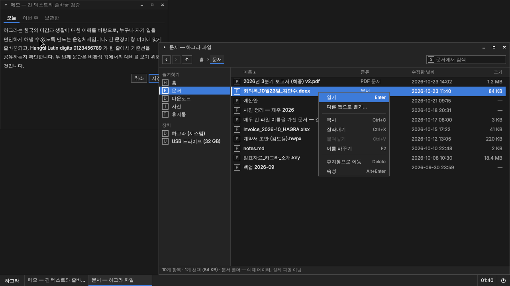

# UI 구현 기반 — 토큰·공통 부품·갤러리·대표 장면

> 2026-10-24 기준. 기존 M0/M1(x86-64 ISO, ARM64 번들) 과 Android 트랙은 그대로 두고, 그 위에 디자인을 받아 적용·비교할 수 있는 기반을 더한 것이다.

## 1. 토큰: 한곳에서 관리

```
design/tokens/hagra.tokens.json   ← 단일 원본 (JSON, 임시값 = 이전 Graphite)
        │  python3 design/tools/gen_tokens.py        (--check: 어긋나면 실패)
        ├─► libs/minui/qml/MinUI/Theme.qml           QML 앱 내부 UI (MinUI 싱글톤)
        ├─► session/labwc/themerc-override          labwc 서버 측 창 장식·루트 메뉴·Alt+Tab OSD
        └─► session/foot/foot.ini                   foot 터미널 색상
```

- 생성된 세 파일은 헤더에 "생성된 파일" 표시가 있고 직접 수정하지 않는다. `make tokens` 로 재생성, `make tokens-check` 로 검증한다.
- 셸 패널(`shell/qml`)은 MinUI `Theme` 을 그대로 쓰므로 별도 반영이 필요 없다.
- 적용 범위가 다른 이유: labwc 와 foot 은 QML 이 아니라 각자의 설정 파일을 읽는다. 생성기가 같은 값을 각 형식으로 써 준다.
  값이 어긋나면 `--check` 가 실패하므로 CI/`make test` 에서 잡는다.
- 토큰 JSON 의 `_meta.status` 가 `provisional` 인 동안은 모든 값이 임시다. 디자인 담당이 보낸 토큰으로 교체하면 `final` 로 바꾼다.

### 1.1 논리 픽셀과 실제 픽셀

| 층 | 단위 | 비고 |
|---|---|---|
| QML (MinUI, 셸, 앱) | **논리 픽셀** (배율 1.0 기준) | Qt 가 Wayland 출력 배율(정수) 또는 `QT_SCALE_FACTOR` 를 곱해 실제 픽셀로 그린다 |
| labwc themerc | **실제 픽셀을 출력 배율로 나눈 값**, 즉 논리 픽셀 | labwc 가 출력 배율을 곱한다. `border.width: 1` 은 2× 출력에서 2px |
| labwc 글꼴 | **pt** (`<font size="9">`) | 배율과 DPI 를 labwc/pango 가 처리 |
| foot | 글꼴 pt, 패딩 px(논리) | foot 이 출력 배율을 적용 |
| 캡처 PNG | 실제 픽셀 | 1280×720@1× → 1280×720, 2560×1440@2× → 2560×1440 |

Qt 6.4 는 분수 배율 프로토콜(`wp-fractional-scale-v1`)이 없어 1.5× 출력에서는 컴포지터가 1× 또는 2× 버퍼를 확대한다(흐림).
갤러리의 150% 캡처는 `QT_SCALE_FACTOR=1.5`(앱 논리 배율)로 배치를 검증하는 용도다.

## 2. 공통 부품 (MinUI, `libs/minui/qml/MinUI/`)

QML 로 직접 작성했다. Qt Quick Controls 를 쓰지 않는 이유와 제약:

- 이유: 각진 형태·1px 테두리·상태 단서를 토큰 하나로 통제하고, Controls 의 스타일 계층(Basic/Fusion)과 애니메이션을 피하며,
  Qt 6.4 ~ 6.8 에서 동일하게 보이게 하기 위해서다. 의존성이 QtQuick 만으로 줄어 소프트웨어 렌더링 비용도 낮다.
- 제약: Controls 가 제공하는 접근성 트리(`Accessible` 역할), 입력 메서드 힌트, 휠·터치 기본 처리를 직접 붙여야 한다.
  현재 `Accessible.role` 은 붙이지 않았다 → 후속 과제. 키보드 탐색은 `activeFocusOnTab` + `Keys` 로 구현했다.
- 선택과 포커스는 독립이다: 선택 = `selection` 배경 + 왼쪽 3px 막대(또는 하단 막대), 포커스 = 1px 링(`focusRing`).

| 부품 | 파일 | 구현 주체 | 상태 지원 (기본/호버/눌림/선택/포커스/비활성/오류/진행) |
|---|---|---|---|
| 창 프레임 | labwc SSD (`session/labwc/themerc-override`) | **컴포지터** | 활성/비활성만. 호버는 버튼 배경. QML 은 관여 못 함. `MWindowFrameMock` 은 미리보기 모형 |
| 버튼 | `MButton.qml` | MinUI | 전부 |
| 입력칸 | `MTextField.qml` | MinUI | 전부 + 한글 조합 중 표시(`composing`) |
| 검색창 | `MSearchField.qml` | MinUI | 입력칸과 동일 + 지우기 |
| 메뉴 | `MMenu.qml` (앱 내) / labwc 루트 메뉴 / 셸 메뉴(layer-shell) | MinUI · 컴포지터 · 셸 | 호버/선택(현재)/비활성/구분선/체크. 창 경계 안에서만 |
| 탭 | `MTabBar.qml` | MinUI | 기본/호버/현재/포커스/비활성 |
| 체크박스 | `MCheckBox.qml` | MinUI | 전부(진행 제외) |
| 라디오 | `MRadioButton.qml` + `MRadioGroup.qml` | MinUI | 전부(진행 제외) |
| 선택 목록 | `MComboBox.qml` | MinUI | 버튼과 동일, 목록은 MMenu |
| 목록 행 | `MListRow.qml` | MinUI | 기본/호버/선택/포커스/비활성 |
| 스크롤바 | `MScrollBar.qml` | MinUI | 기본/호버/드래그 |
| 툴팁 | `MToolTip.qml` | MinUI | 표시/숨김 (창 안) |
| 알림 | `MNotification.qml` | **셸 소유**(M2 에서 layer-shell 창) | 기본/긴급/동작 버튼 |
| 대화상자 | `MDialogWindow.qml`(별도 창, labwc 장식) / `MDialogContent.qml` | MinUI + 컴포지터 | 기본 버튼/거부/파괴적 |
| 진행 표시 | `MProgressBar.qml`, `MBusyBar.qml` | MinUI | 확정/불확정/오류 |
| 앱 실행·전환 영역 | `shell/qml/Panel.qml`, `Launcher.qml` | **셸** | 활성 창 = 하단 막대 |
| 아이콘 | `MIcon.qml` | MinUI | SVG 자산 없으면 자리 표시자 |

### 2.1 시스템 소유 UI 와 외부 앱

| 범위 | 테마 적용 |
|---|---|
| 하그라 셸·하그라 앱(QML) | MinUI 토큰 100% |
| 창 장식·루트 메뉴·Alt+Tab | labwc themerc (토큰 생성) — 모든 창에 동일 적용(SSD) |
| 터미널(foot) | foot.ini 색상(토큰 생성) |
| 외부 Qt 앱 | 창 장식만 동일. 내부는 앱의 스타일. (후속: Qt 플랫폼 테마 플러그인으로 색상 제안 가능) |
| 외부 GTK 앱 | 창 장식만 동일(CSD 앱은 그마저도 자체). GTK 테마는 별도 작업이며 강제할 수 없다 |
| 웹 콘텐츠 | 적용 불가 |

## 3. 갤러리

```sh
make shell                                   # build/tools/preview/minui-preview 포함
build/tools/preview/minui-preview libs/minui/gallery/Gallery.qml --state buttons [--scale 1.5]
   # 섹션: buttons inputs selection lists feedback text frame
tests/design/capture-gallery.sh              # 7 섹션 × 100/150/200% → out/design/gallery/<섹션>-<배율>.png
```
갤러리는 헤드리스 labwc(pixman) + Qt Wayland(software) 에서 실행되므로 이미지와 같은 경로로 그려진다.

## 4. 대표 장면

"하그라 바탕화면에서 파일 관리자를 열고, 문서 폴더의 파일을 선택하는 장면"

```sh
tests/design/capture-scene.sh    # out/design/scene/scene-100-{default,menu,dialog}.png, scene-200-default.png
build/tools/preview/minui-preview design/scenes/FilesScene.qml --state menu   # 직접 실행
```
구성: 배경(swaybg) + 셸 패널(minos-shell, 실제 창 목록) + 비활성 창(`NotesScene.qml`, 긴 텍스트·탭) + 활성 창(`FilesScene.qml`).
창 장식·이동·크기 조절·창 제어는 labwc 가 실제로 처리한다(모형 아님). **파일 목록은 예제 데이터이며 실제 파일 작업은 없다.**
실제 파일 관리자는 M3 에서 `files/` 에 구현하며, 이 장면의 레이아웃·부품을 그대로 가져간다.

캡처 환경: 1280×720@1× 및 2560×1440@2×(wlr-randr 출력 배율 → labwc 장식도 확대). 창 배치는 캡처용 설정에서 `automatic`.

### 4.1 현재 캡처 (임시 Graphite 토큰, 2026-10-24)

| 장면 | 파일 |
|---|---|
| 파일 장면 100% 기본 | `docs/screenshots/h0/scene-files-100.png` |
| 파일 장면 100% 메뉴 열림 | `docs/screenshots/h0/scene-files-100-menu.png` |
| 파일 장면 100% 확인 대화상자 | `docs/screenshots/h0/scene-files-100-dialog.png` |
| 갤러리 buttons / inputs / selection / lists / feedback 100% | `docs/screenshots/h0/gallery-*-100.png` |
| 갤러리 text 200% | `docs/screenshots/h0/gallery-text-200.png` |



## 5. 자산 경로

| 종류 | 경로 | 설치 위치 |
|---|---|---|
| 토큰 | `design/tokens/hagra.tokens.json` | (생성물만 설치) |
| 아이콘 | `design/assets/icons/<name>.svg` | `/usr/share/hagra/icons/` (CMake install) |
| 배경 | `design/assets/wallpaper/` (확정 후) / 현재 `session/wallpaper/min-graphite.png`(임시 단색) | `/usr/share/minos/wallpaper/` |
| 기준 이미지 | `design/reference/` (디자인 담당 제공) | — |
| 캡처 결과 | `out/design/` (git 제외), 대표본은 `docs/screenshots/` | — |

아이콘은 `MIcon { name: "folder" }` 로 참조한다. 자산이 없으면 머리글자 자리 표시자를 그린다 (현재 상태).
미리보기 실행기는 `HAGRA_ICON_PATH` 또는 `--icons DIR` 로 경로를 받는다.

## 6. 이번 작업에서 바꾼 것과 바꾸지 않은 것

| 바꿈 | 바꾸지 않음 |
|---|---|
| 토큰 원본·생성기, MinUI 부품 17종 추가/확장, 미리보기 실행기, 갤러리, 대표 장면, 캡처 스크립트 | 부팅 파이프라인 구조, 세션 흐름, 셸 동작, 테스트 시나리오, x86/ARM64 공통 UI 경로 |
| 사용자 노출 이름(GRUB 항목, `/etc/issue`, 세션 항목, 패널 브랜드 라벨, Android 안내) → 하그라/HAGRA | 내부 식별자(`minos-*`, `/etc/minos`, `MinUI`), 호스트명, 패키지 목록 |
| 배경 이미지: MIN 워드마크 제거(임시 단색) | 배경 파일명·설치 경로 |
